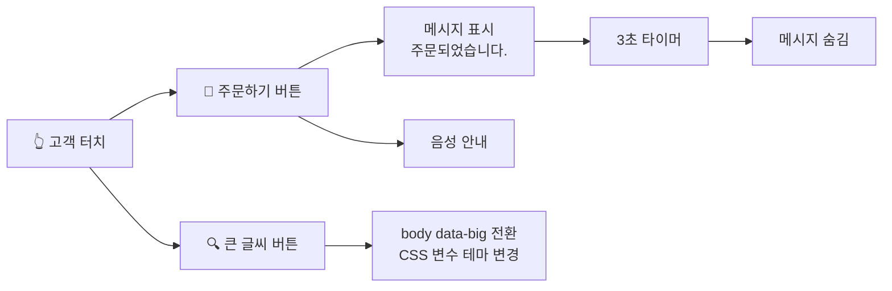
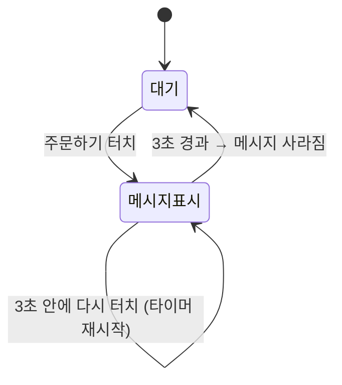
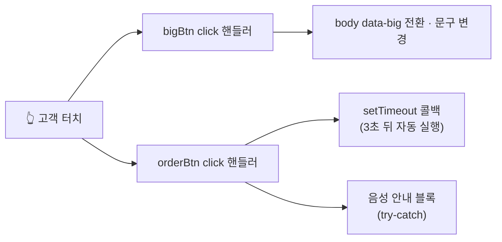
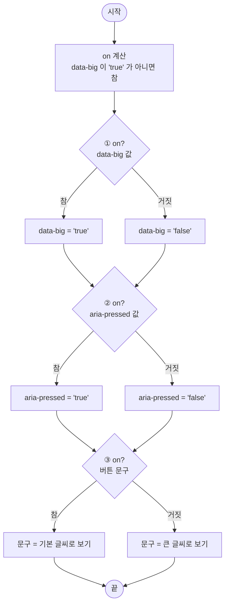
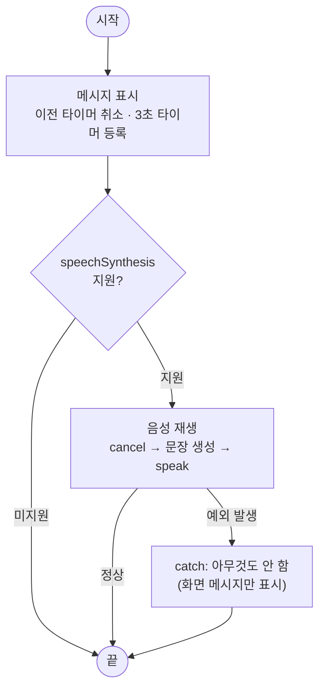
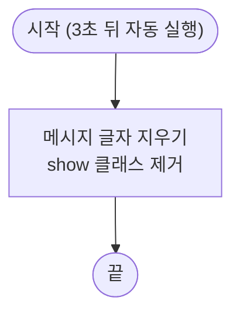

# b2b-system
# 버거킹 베리어프리 주문 키오스크 개발

## 요구사항
> 프로젝트 코드명: **모두의 와퍼 (Whopper for All)**
> MVP 한 줄 정의: **"손이 닿지 않아도, 글씨가 작아도 — 혼자 주문 버튼을 누를 수 있다."**

### 1. 개발 방향
처음부터 완전한 SW를 만들지 않고, **판매하거나 투자자를 설득할 수 있는 핵심 기능만** 짧은 시간 안에 만든다.

| 항목 | 내용 |
|---|---|
| 문제 | 기존 키오스크는 버튼이 높고 글씨가 작아 휠체어 사용자·어린이·고령자가 혼자 주문하기 어렵다 |
| 해결 | 화면 아래쪽에 큰 주문 버튼을 두고, 버튼 하나로 큰 글씨·고대비 화면으로 바꾼다 |
| 실행 환경 | 터치형 키오스크의 내장 브라우저 |
| 결과물 | HTML 파일 1개 (인터넷 연결·서버 불필요) |

### 2. 핵심 타깃
| 페르소나 | 어려움 | 해결 기능 |
|---|---|---|
| 🧑‍🦽 민준 (휠체어) | 위쪽 버튼에 손이 닿지 않음 | REQ-2 하단 집중 배치 |
| 🧒 하윤 (어린이·저신장) | 높은 화면에 손이 닿지 않음 | REQ-2 하단 집중 배치 |
| 👴 순자 (고령) | 작은 글씨가 잘 안 보임 | REQ-3 큰 글씨·고대비 |

### 3. 기능 요구사항
| ID | 기능 | 설명 | 우선순위 |
|---|---|---|---|
| REQ-1 | 🛒 주문 버튼 | 버튼을 누르면 **"주문되었습니다."** 메시지가 뜨고, **약 3초 후 사라진다.** 사라진 뒤 **다시 누를 수 있다.** 3초 안에 다시 누르면 3초를 처음부터 다시 센다 | **P1 (필수)** |
| REQ-2 | 🧑‍🦽 하단 집중 배치 | 메시지·큰 글씨 버튼·주문 버튼을 모두 화면 아래 절반에 둔다. 위쪽에는 제목과 안내 문구만 둔다 | **P2 (필수)** |
| REQ-3 | 🔍 큰 글씨·고대비 | 버튼 하나로 글씨 약 1.5배 + 검은 배경·노란 강조색으로 바꾼다. 다시 누르면 원래대로 돌아온다 | **P3 (필수)** |
| REQ-4 | 🔊 음성 안내 | 주문 시 "주문되었습니다."를 음성으로도 안내한다. 지원하지 않는 브라우저에서는 화면 메시지만 보여준다 | P4 (보너스) |

**우선순위를 정한 기준**
- 짧은 시간 안에 완성할 수 있는가
- 터치 키오스크에서 바로 눈으로 보여줄 수 있는가 (키보드 조작은 터치 키오스크에서 시연할 수 없어 제외)
- 시연이 실패할 위험이 낮은가 (음성은 브라우저에 따라 안 나올 수 있어 보너스로 낮춤)

### 4. 비기능 요구사항
| ID | 항목 | 기준 |
|---|---|---|
| NFR-1 | 오프라인 동작 | 인터넷 없이 HTML 파일을 열어 동작 |
| NFR-2 | 터치 영역 | 주문 버튼 높이 160px (큰 글씨 모드 200px), 큰 글씨 버튼 높이 100px |
| NFR-3 | 개인정보 | 어떤 정보도 저장하지 않음 (새로고침하면 초기화) |

### 5. 이번 범위에서 제외 (로드맵)
| 기능 | 제외 이유 |
|---|---|
| 메뉴 선택·세트·장바구니·결제 | 화면 여러 개가 필요해 이번 범위로는 불가 |
| 키패드(키보드) 조작 | 터치 키오스크에는 키보드가 없어 시연 불가 |
| 직원 호출, 시간 연장 | 베리어프리 차별점이 약해 다음 버전으로 |
| 수어 영상, 다국어 | 콘텐츠 제작 비용이 큼 |

## 설계
### 1. 구조
HTML 파일 1개 안에 화면(HTML), 디자인(CSS), 동작(JavaScript)을 모두 담는다.



### 2. 화면 설계 (세로형 키오스크 기준)
```
┌──────────────────────────┐
│      🍔 모두의 와퍼       │  ← 위쪽: 제목·안내만 (누를 것 없음)
│ 아래 버튼을 눌러 주문하세요 │
│                          │
├──────────── 50% ─────────┤
│   [ 주문되었습니다. ]     │  ← 메시지 영역 (3초 후 사라짐)
│ [ 🔍 큰 글씨로 보기 ]     │  ← REQ-3
│ [      🛒 주문하기     ]  │  ← REQ-1 (가장 크게, 맨 아래)
└──────────────────────────┘
```

### 3. 주문 버튼 동작 흐름 (REQ-1)


### 4. 화면 요소
| 요소 | id | 역할 | 관련 요구사항 |
|---|---|---|---|
| 메시지 영역 | `message` | "주문되었습니다." 표시. `aria-live`로 스크린리더도 읽음 | REQ-1 |
| 큰 글씨 버튼 | `bigBtn` | 큰 글씨·고대비 켜기/끄기. `aria-pressed`로 상태 표시 | REQ-3 |
| 주문 버튼 | `orderBtn` | 메시지 표시 + 음성 안내 | REQ-1, REQ-4 |

### 5. 테마 설계 (REQ-3)
CSS 변수로 두 가지 테마를 정의하고, `body`의 `data-big` 값만 바꿔서 전환한다.

| 항목 | 기본 | 큰 글씨·고대비 |
|---|---|---|
| 배경 / 글자 | 베이지 `#f5ebdc` / 갈색 `#502314` | 검정 `#000000` / 흰색 `#ffffff` |
| 주문 버튼 | 빨강 `#d62300` + 흰 글자 | 노랑 `#ffd200` + 검은 글자 |
| 메시지 글자색 | 초록 `#198737` | 노랑 `#ffd200` |
| 주문 버튼 글씨 / 높이 | 48px / 160px | 72px / 200px |
| 메시지 글씨 | 40px | 64px |
| 큰 글씨 버튼 글씨 | 28px | 40px |
| 제목 / 안내 글씨 | 36px / 22px | 56px / 36px |

### 6. 화면 설계 규칙
- 누를 수 있는 요소는 모두 화면 아래 절반에 둔다
- 버튼은 화면 폭에 맞춰 크게 만든다 (`width: 100%`)
- 색만으로 구분하지 않고 아이콘과 글자를 함께 표시한다
- 더블탭 확대를 막아 실수로 화면이 커지지 않게 한다 (`touch-action: manipulation`)

## 코딩
### 1. 기술 스택
| 영역 | 선택 | 이유 |
|---|---|---|
| 화면 | HTML 파일 1개 | 키오스크 내장 브라우저에서 바로 열림 |
| 디자인 | CSS 변수 + `data-big` 속성 | 테마 전환을 CSS만으로 처리 |
| 동작 | 순수 JavaScript | 라이브러리 설치 없이 동작 |
| 음성 | Web Speech API | 브라우저 내장, 추가 비용 없음 |

### 2. 하단 집중 배치 (REQ-2)
```css
body {
  display: flex;
  flex-direction: column;
  justify-content: flex-end;      /* 콘텐츠를 화면 하단으로 */
  align-items: center;
}
.top {
  position: fixed; top: 0; left: 0; right: 0;   /* 제목은 위쪽에 고정 */
}
.bottom {
  width: 100%; max-width: 760px;
  min-height: 50vh;
  display: flex; flex-direction: column;
  justify-content: flex-end; gap: 20px;
}
```

### 3. 큰 글씨·고대비 테마 (REQ-3)
```css
:root {
  --bg: #f5ebdc; --fg: #502314;
  --btn-bg: #d62300; --btn-fg: #ffffff;
  --order-fs: 48px; --order-h: 160px; --msg-fs: 40px;
}
body[data-big="true"] {
  --bg: #000000; --fg: #ffffff;
  --btn-bg: #ffd200; --btn-fg: #000000;
  --order-fs: 72px; --order-h: 200px; --msg-fs: 64px;
}
```
```js
// 큰 글씨·고대비 켜기/끄기
bigBtn.addEventListener('click', function () {
  const on = body.dataset.big !== 'true';
  body.dataset.big = on ? 'true' : 'false';
  bigBtn.setAttribute('aria-pressed', on ? 'true' : 'false');
  bigBtn.textContent = on ? '🔍 기본 글씨로 보기' : '🔍 큰 글씨로 보기';
});
```

### 4. 주문 버튼 + 3초 후 메시지 사라짐 (REQ-1)
```js
orderBtn.addEventListener('click', function () {
  msg.textContent = '주문되었습니다.';
  msg.classList.add('show');

  clearTimeout(hideTimer);          // 연속으로 누르면 3초를 다시 셈
  hideTimer = setTimeout(function () {
    msg.textContent = '';
    msg.classList.remove('show');
  }, 3000);
  // ↓ 음성 안내 (REQ-4)
});
```

### 5. 음성 안내 (REQ-4)
```js
try {
  if ('speechSynthesis' in window) {
    speechSynthesis.cancel();
    const u = new SpeechSynthesisUtterance('주문되었습니다.');
    u.lang = 'ko-KR';
    speechSynthesis.speak(u);
  }
} catch (e) { /* 음성 미지원: 화면 메시지만 표시 */ }
```

### 6. 커밋 규칙
| 타입 | 예시 |
|---|---|
| feat | `feat: 주문 버튼 클릭 시 "주문되었습니다." 메시지 표시` |
| feat | `feat: 메시지 3초 후 자동 사라짐` |
| feat | `feat: 큰 글씨·고대비 전환 버튼 추가` |
| fix | `fix: 연속 클릭 시 메시지가 중간에 사라지는 문제 수정` |

### 8. 개발 일정 (예시: 2주)
| 주차 | 작업 |
|---|---|
| 1주차 | 기본 주문 흐름(FR-01), 하단 모드(FR-04), 큰 글씨(FR-05) |
| 2주차 | 음성 안내(FR-02), 키 조작(FR-03), 시간 연장·직원 호출, 테스트 |

### 9. 커밋 규칙
`feat(a11y): 메뉴 포커스 시 이름·가격 음성 안내` / `fix(order): 세트 금액 계산 오류 수정`

## 테스트
### 1. 테스트 방법
직접 HTML 파일을 브라우저로 열어 버튼을 눌러 보는 **수동 테스트**로 진행했다.

| 항목 | 내용 |
|---|---|
| 테스트 대상 | HTML 파일 1개 (v0.1.0) |
| 테스트 방법 | 수동 테스트 (직접 터치·클릭) |
| 테스트 환경 | (사용한 기기·브라우저 기입) |

### 2. 테스트 결과
| ID | 테스트 항목 | 방법 | 기대 결과 | 결과 |
|---|---|---|---|---|
| TC-01 | 주문 메시지 표시 | 🛒 주문하기 버튼을 누른다 | "주문되었습니다." 메시지가 뜬다 | ✅ 통과 |
| TC-02 | 메시지 자동 사라짐 | 버튼을 누르고 약 3초 기다린다 | 3초 후 메시지가 사라진다 | ✅ 통과 |
| TC-03 | 재주문 | 메시지가 사라진 뒤 다시 버튼을 누른다 | 다시 누를 수 있고 메시지가 또 뜬다 | ✅ 통과 |
| TC-04 | 연속 누름 | 메시지가 떠 있는 동안 다시 누른다 | 메시지가 중간에 사라지지 않고, 마지막으로 누른 때부터 3초 후 사라진다 | ☐ 미실시 |
| TC-05 | 큰 글씨 켜기 | 🔍 큰 글씨로 보기 버튼을 누른다 | 글씨가 커지고 검은 배경·노란 버튼으로 바뀐다. 버튼 문구가 "기본 글씨로 보기"로 바뀐다 | ☐ 미실시 |
| TC-06 | 큰 글씨 끄기 | 큰 글씨 버튼을 다시 누른다 | 원래 화면으로 돌아온다 | ☐ 미실시 |
| TC-07 | 하단 배치 | 화면을 눈으로 확인한다 | 모든 버튼이 화면 아래 절반에 있다 (큰 글씨 모드 포함) | ☐ 미실시 |
| TC-08 | 음성 안내 | 주문하기 버튼을 누른다 | "주문되었습니다." 음성이 나온다 (미지원 브라우저면 화면 메시지만) | ☐ 미실시 |

### 3. 정적 분석 (코드 → 그래프 변환, 복잡도 계산)

#### 3-1. 분석 방법
정적 분석은 프로그램을 **실행하지 않고 코드만 읽어서** 구조를 분석하는 방법이다.

1. 코드를 **제어 흐름 그래프(CFG)** 로 변환한다.
   - 노드(N): 코드 덩어리 또는 판단 지점
   - 간선(E): 실행이 이어지는 길
2. 그래프로 **순환 복잡도(McCabe)** 를 계산한다.
   - 함수 1개 기준 `M = E − N + 2`
   - 같은 값: `M = 판단 지점 수 + 1`
   - 판단 지점: `if`, 삼항 연산자(`? :`), `catch`, 반복문, `&&`/`||` 등
   - M은 서로 다른 실행 경로의 최소 개수이며, 이 경로를 모두 지나 보는 데 필요한 최소 테스트 수이기도 하다.
3. 해석 기준(널리 쓰는 기준): 1~10 단순 · 11~20 보통 · 21~50 복잡 · 50 초과 테스트하기 어려운 수준

| 항목 | 내용 |
|---|---|
| 분석 대상 | 문서 `코딩` 3~5장의 JavaScript 코드 3개 함수 (큰 글씨 버튼 핸들러, 주문 버튼 핸들러, 3초 타이머 콜백) |
| 제외 | CSS (분기 로직 없음) |
| 가정 | 음성 안내 블록(try-catch)은 주문 버튼 핸들러 안에서 실행된다 (설계 4장: 주문 버튼 = 메시지 표시 + 음성 안내) |
| 계산 방법 | 그래프로 수동 계산 후, ESLint `complexity` 규칙으로 교차 확인 (결과 일치) |

#### 3-2. 호출 그래프 (전체 흐름)


#### 3-3. 함수별 제어 흐름 그래프 (CFG)

**① 큰 글씨 버튼 핸들러 (`bigBtn` click)** — 노드 12, 간선 14


**② 주문 버튼 핸들러 (`orderBtn` click, 음성 안내 포함)** — 노드 6, 간선 7


**③ 3초 타이머 콜백 (`setTimeout`)** — 노드 3, 간선 2


#### 3-4. 복잡도 계산 결과
| 함수 | 노드 N | 간선 E | 판단 지점 | 복잡도 M | 등급 |
|---|---|---|---|---|---|
| ① 큰 글씨 버튼 핸들러 | 12 | 14 | 3 (삼항 연산자 3개) | **4** (14 − 12 + 2) | 단순 |
| ② 주문 버튼 핸들러 | 6 | 7 | 2 (`if` 1, `catch` 1) | **3** (7 − 6 + 2) | 단순 |
| ③ 3초 타이머 콜백 | 3 | 2 | 0 | **1** (2 − 3 + 2) | 단순 |
| **합계** | 21 | 23 | 5 | **8** | |

- 최대 복잡도 4, 평균 약 2.7로 기준(10 이하)보다 훨씬 낮다. 판단 지점은 전체 5개뿐이라 구조가 단순하다.
- 음성 안내 블록을 주문 핸들러에서 분리해 별도 함수로 두더라도, 합계(8)는 같다.

#### 3-5. 실행 경로와 테스트 케이스 연결
| 함수 | 경로 | 대응 테스트 |
|---|---|---|
| ① 큰 글씨 핸들러 | 켜기 (`on` = 참) | TC-05 |
| ① 큰 글씨 핸들러 | 끄기 (`on` = 거짓) | TC-06 |
| ② 주문 핸들러 | 음성 지원 + 정상 재생 | TC-01, TC-08 |
| ② 주문 핸들러 | 음성 미지원 (화면 메시지만) | TC-08 (미지원 브라우저 조건) |
| ② 주문 핸들러 | 음성 지원이지만 실행 중 예외 (`catch`) | 대응하는 TC 없음 |
| ③ 타이머 콜백 | 3초 후 메시지 사라짐 | TC-02 |

- ①은 계산상 M = 4이지만, 삼항 연산자 3개가 모두 같은 조건(`on`)을 쓰므로 **실제로 가능한 경로는 2개**(켜기·끄기)다.
- 연속 누름(TC-04)은 `clearTimeout`으로 타이머를 다시 세는 **상태 의존 동작**이라 분기가 아니다. 복잡도 수치에는 잡히지 않으므로 TC-04는 별도로 필요하다.

#### 3-6. 분석의 한계
- 문서에 발췌된 코드 기준이다. HTML 파일 전체(초기화 코드 등)를 분석한 것은 아니다.
- 순환 복잡도는 코드 구조의 단순함을 보여줄 뿐, 동작이 올바른지는 보장하지 않는다. 실제 동작은 TC-01~08(수동 테스트)로 확인한다.

## 출시
### 1. 출시 목적
완성품 출시가 아니라 **"이 기능만으로도 쓸 사람이 있다"는 것을 확인하는 단계**다.

### 2. 배포 방법
1. HTML 파일을 키오스크(또는 태블릿·PC)에 복사한다.
2. 키오스크 내장 브라우저에서 파일을 연다. (인터넷 연결 불필요)
3. 또는 GitHub Pages에 올려 링크로 연다.

### 3. 릴리스 노트
```
## v0.1.0 (MVP) — 모두의 와퍼 🎉
✨ 주문하기 버튼 → "주문되었습니다." 메시지 표시, 약 3초 후 자동으로 사라짐
✨ 메시지가 사라진 뒤 다시 주문 가능 (연속으로 누르면 3초 재시작)
✨ 휠체어 사용자·어린이를 위해 모든 버튼을 화면 아래쪽에 배치
✨ 큰 글씨·고대비 전환 버튼 (고령자·저시력자)
🔊 주문 메시지 음성 안내 (지원 브라우저에서만)
🔒 어떤 정보도 저장하지 않음
```

### 4. 알려진 제한
- 음성 안내는 키오스크 브라우저에 따라 나오지 않을 수 있다.
- 메뉴 선택·결제는 아직 없다 (주문 버튼은 시연용).
- 화면이 작은 기기에서는 큰 글씨 모드에서 버튼이 화면 아래 절반을 넘을 수 있다.

### 5. 다음 단계 (로드맵)
| 버전 | 추가 기능 |
|---|---|
| v0.2.0 | 메뉴 선택(대표 메뉴 3개), 메시지에 메뉴 이름·주문번호 표시 |
| v0.3.0 | 직원 호출, 시간 연장 |
| v1.0.0 | 세트 선택·장바구니·모의 결제, 키패드 조작 |
