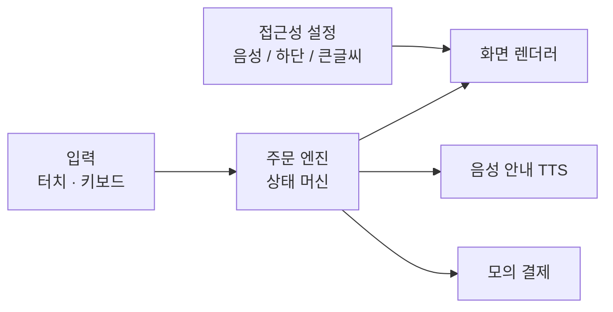
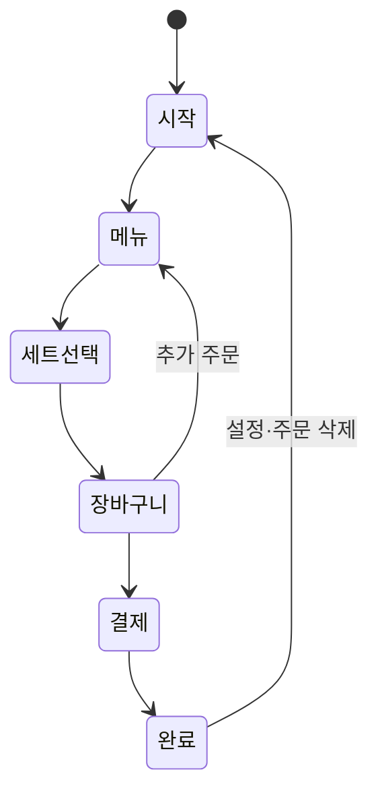

# b2b-system
# 버거킹 베리어프리 주문 키오스크 개발
## 요구사항
## 📋 요구사항 (MVP)
> 프로젝트 코드명: **모두의 와퍼 (Whopper for All)**
> MVP 한 줄 정의: **"화면을 보지 않아도, 손이 닿지 않아도, 글씨가 작아도 — 혼자 주문을 끝낸다."**

### 1. 왜 이 제품인가 (판매·투자 포인트)
| 포인트 | 내용 |
|---|---|
| 문제 | 기존 키오스크는 시각장애인·휠체어 사용자·고령자가 혼자 주문하기 어려움 |
| 시장 흐름 | 키오스크 접근성 의무화가 진행 중 (적용 시점·대상은 법령 확인 필요) |
| 해결 | **기존 키오스크에 소프트웨어 업데이트만으로** 적용하는 접근성 모드 |
| 차별점 | 이어폰을 꽂으면 화면 없이 음성과 버튼만으로 주문 완료 |

### 2. 핵심 타깃 (MVP)
| 페르소나 | 어려움 | MVP 해결 기능 |
|---|---|---|
| 🧑‍🦯 서연 (시각장애) | 화면을 볼 수 없음 | 핵심 1: 음성 안내 + 키패드 |
| 🧑‍🦽 민준 (휠체어) | 상단 버튼에 손이 닿지 않음 | 핵심 2: 하단 집중 모드 |
| 👴 순자 (고령) | 작은 글씨, 짧은 제한시간 | 핵심 3: 큰 글씨·고대비 + 시간 연장 |

### 3. 기능 요구사항 (MVP 범위)
| ID | 기능 | 설명 | 구분 |
|---|---|---|---|
| FR-01 | 기본 주문 흐름 | 메뉴 → 세트 선택 → 장바구니 → 결제(모의) → 호출번호 | 기반 |
| FR-02 | 🎧 음성 안내 모드 | 현재 화면, 선택 항목, 금액을 음성으로 안내 | **핵심 1** |
| FR-03 | ⌨️ 키패드 조작 | 이전/다음/선택/직원호출 4개 키로 전 과정 조작 | **핵심 1** |
| FR-04 | 🧑‍🦽 하단 집중 모드 | 모든 버튼을 화면 하단 절반에 배치 | **핵심 2** |
| FR-05 | 🔍 큰 글씨·고대비 | 버튼 하나로 글씨 2배 + 고대비 테마 전환 | **핵심 3** |
| FR-06 | 직원 호출 | 모든 화면 같은 위치에 고정 | 기반 |
| FR-07 | 시간 연장 | 초기화 10초 전 경고, 버튼 한 번으로 연장 | 기반 |

### 4. 비기능 요구사항
| ID | 항목 | 기준 |
|---|---|---|
| NFR-01 | 접근성 | 핵심 화면 axe 자동 검사 위반 0건 |
| NFR-02 | 반응성 | 버튼 조작 후 음성 안내 시작 0.5초 이내 |
| NFR-03 | 개인정보 | 접근성 설정은 주문 종료 시 즉시 삭제 |

### 5. MVP에서 제외 (로드맵)
| 기능 | 제외 이유 | 예정 |
|---|---|---|
| 수어 영상·자막 | 영상 제작 비용 큼 | v1.1 |
| 쉬운 주문 모드 | 메뉴 콘텐츠 재설계 필요 | v1.1 |
| 다국어 | 핵심 가치와 거리 있음 | v1.2 |
| 실제 결제·매장 서버 연동 | 제휴·인증 필요, 데모는 모의로 충분 | v1.2 |
| 전용 하드웨어(점자 키패드 등) | MVP는 일반 키보드·숫자패드로 대체 | v2.0 |

## 설계
## 🧭 설계 (MVP)
### 1. 설계 원칙: "하나의 주문 엔진, 세 가지 보기 방식"
주문 로직은 하나만 만들고 화면을 보여주는 방식만 바꾼다. 그래서 기능을 추가해도 개발량이 크게 늘지 않는다.


> 서버 없이 브라우저 하나로 동작한다. 메뉴는 JSON 파일로, 결제는 모의 처리로 대신한다.

### 2. 주문 흐름

> 모든 화면 공통: ◀ 이전 / 🔔 직원 호출 / ⏱ 시간 연장

### 3. 화면 목록 (5개)
| ID | 화면 | 핵심 내용 | 관련 FR |
|---|---|---|---|
| SC-01 | 시작 | 접근성 버튼 3개 (🎧 음성 / 🧑‍🦽 하단 / 🔍 큰 글씨) + "주문 시작" | FR-02, 04, 05 |
| SC-02 | 메뉴 | 대표 메뉴 6개 (와퍼, 치즈와퍼, 불고기와퍼 등) | FR-01 |
| SC-03 | 세트 선택 | 단품 / 세트 | FR-01 |
| SC-04 | 장바구니·결제 | 주문 요약, 금액, 결제(모의) | FR-01 |
| SC-05 | 완료 | 호출번호 (큰 글씨 + 음성) | FR-01, 02 |

### 4. 키 설계 (FR-03)
| 키 | 기능 | 실제 제품에서는 |
|---|---|---|
| ← | 이전 항목 | 왼쪽 돌기 버튼 |
| → | 다음 항목 | 오른쪽 돌기 버튼 |
| Enter | 선택 | 가운데 원형 버튼 |
| Esc | 이전 화면 | 뒤로 버튼 |
| F1 | 직원 호출 | 별도 색·모양 버튼 |

### 5. 화면 설계 규칙
- 한 화면에 선택지는 최대 6개
- 버튼 최소 크기 48×48px 이상
- 직원 호출·이전 버튼은 모든 화면에서 같은 자리
- 색만으로 구분하지 않고 아이콘과 글자를 함께 표시
- 화면 순서, 음성 읽기 순서, 키 이동 순서를 같게

### 6. 데이터
```json
// menu.json
[
  { "id": "whopper", "name": "와퍼", "price": 7100, "setPrice": 9100 },
  { "id": "cheese", "name": "치즈와퍼", "price": 7700, "setPrice": 9700 }
]
```
> 가격은 데모용 예시이며 실제 가격이 아니다.

```json
// 접근성 설정 (메모리에만 보관, 주문 종료 시 삭제)
{ "audio": true, "lowReach": false, "bigText": true }
```

## 코딩
## 💻 코딩 (MVP)
### 1. 기술 스택 (가볍게)
| 영역 | 선택 | 이유 |
|---|---|---|
| 화면 | React + TypeScript (Vite) | 빠른 개발, 화면 모드 전환이 쉬움 |
| 음성 | Web Speech API | 브라우저 내장, 추가 비용 없음 |
| 스타일 | CSS Variables + data 속성 | 모드 전환을 CSS로 처리 |
| 데이터 | menu.json | 서버 없이 데모 가능 |
| 배포 | GitHub Pages | 링크 하나로 시연 |

### 2. 폴더 구조
```
src/
├─ order/      # 주문 상태 머신, 장바구니      (FR-01)
├─ a11y/       # 음성 안내, 접근성 설정        (FR-02, 05)
├─ input/      # 키보드 → 키패드 동작 변환     (FR-03)
├─ screens/    # SC-01 ~ SC-05
├─ styles/     # 하단 모드, 큰 글씨 테마       (FR-04, 05)
└─ data/menu.json
```

### 3. 핵심 1-A: 음성 안내 (FR-02)
```ts
export function speak(text: string) {
  if (!settings.audio) return;
  speechSynthesis.cancel();                 // 이전 안내 끊고 최신 안내만
  const u = new SpeechSynthesisUtterance(text);
  u.lang = 'ko-KR';
  u.rate = 0.95;
  speechSynthesis.speak(u);
}

// 항목에 포커스가 가면 이름과 가격을 읽어 줌
export function speakItem(name: string, price: number, index: number, total: number) {
  speak(`${name}, ${price.toLocaleString()}원. ${total}개 중 ${index + 1}번째.`);
}
```

### 4. 핵심 1-B: 키패드 조작 (FR-03)
```ts
const KEY_MAP = {
  ArrowLeft: 'prev', ArrowRight: 'next',
  Enter: 'select', Escape: 'back', F1: 'help',
} as const;

export function bindKeys(on: Record<string, () => void>) {
  window.addEventListener('keydown', (e) => {
    const action = KEY_MAP[e.key as keyof typeof KEY_MAP];
    if (!action) return;
    e.preventDefault();
    on[action]();
  });
}
```

### 5. 핵심 2: 하단 집중 모드 (FR-04)
```css
[data-low-reach='true'] .screen {
  display: flex;
  flex-direction: column;
  justify-content: flex-end;     /* 모든 콘텐츠를 아래로 */
  min-height: 100vh;
}
[data-low-reach='true'] .content {
  max-height: 50vh;              /* 손이 닿는 범위 */
  overflow-y: auto;
}
```

### 6. 핵심 3: 큰 글씨·고대비 (FR-05)
```css
:root            { --fs: 18px; --bg: #ffffff; --fg: #222222; --accent: #d62300; }
[data-big='true'] { --fs: 36px; --bg: #000000; --fg: #ffffff; --accent: #ffd200; }

body   { font-size: var(--fs); background: var(--bg); color: var(--fg); }
button { min-width: 48px; min-height: 48px; border: 3px solid var(--accent); }
```

### 7. 시간 연장 (FR-07)
```ts
const LIMIT = 60_000, WARN = 10_000;
let timer: number, warnTimer: number;

export function resetIdle() {
  clearTimeout(timer); clearTimeout(warnTimer);
  warnTimer = setTimeout(() =>
    speak('10초 뒤 처음 화면으로 돌아갑니다. 아무 버튼이나 누르면 계속합니다.'), LIMIT - WARN);
  timer = setTimeout(endSession, LIMIT);   // 주문·설정 삭제 (NFR-03)
}
```

### 8. 개발 일정 (예시: 2주)
| 주차 | 작업 |
|---|---|
| 1주차 | 기본 주문 흐름(FR-01), 하단 모드(FR-04), 큰 글씨(FR-05) |
| 2주차 | 음성 안내(FR-02), 키 조작(FR-03), 시간 연장·직원 호출, 테스트 |

### 9. 커밋 규칙
`feat(a11y): 메뉴 포커스 시 이름·가격 음성 안내` / `fix(order): 세트 금액 계산 오류 수정`

## 테스트
## 🧪 테스트 (MVP)
### 1. 테스트 목표
**"핵심 기능 3개가 데모에서 실패하지 않는다."** 이것만 확실히 검증한다.

### 2. 핵심 시나리오
| ID | 페르소나 | 시나리오 | 통과 기준 | 관련 FR |
|---|---|---|---|---|
| TC-01 | 서연 | 화면을 가리고 키보드만으로 와퍼세트 주문 | 화면을 보지 않고 호출번호까지 완료 | FR-02, 03 |
| TC-02 | 민준 | 하단 모드로 주문 | 화면 위쪽 절반을 한 번도 누르지 않고 완료 | FR-04 |
| TC-03 | 순자 | 큰 글씨 모드 + 시간 연장 1회 | 초기화 없이 완료 | FR-05, 07 |
| TC-04 | 공통 | 각 화면에서 직원 호출 | 모든 화면에서 1회 조작으로 호출 | FR-06 |
| TC-05 | 공통 | 주문 완료 후 다음 고객 시작 | 이전 설정·장바구니가 남아 있지 않음 | NFR-03 |

### 3. 자동화 테스트 (Playwright + axe)
```ts
import { test, expect } from '@playwright/test';
import AxeBuilder from '@axe-core/playwright';

test('NFR-01: 핵심 화면 접근성 위반 0건', async ({ page }) => {
  for (const path of ['/', '/menu', '/cart']) {
    await page.goto(path);
    const r = await new AxeBuilder({ page }).analyze();
    expect(r.violations).toEqual([]);
  }
});

test('TC-02: 하단 모드에서 모든 버튼이 화면 아래 절반', async ({ page }) => {
  await page.goto('/menu?lowReach=true');
  const { height } = page.viewportSize()!;
  const tops = await page.locator('button').evaluateAll(els =>
    els.map(e => e.getBoundingClientRect().top));
  tops.forEach(t => expect(t).toBeGreaterThanOrEqual(height / 2));
});

test('TC-01: 키보드만으로 주문 완료', async ({ page }) => {
  await page.goto('/?audio=true');
  for (const key of ['Enter', 'Enter', 'ArrowRight', 'Enter', 'Enter', 'Enter']) {
    await page.keyboard.press(key);
  }
  await expect(page.getByTestId('order-number')).toBeVisible();
});
```

### 4. 데모 전 점검표
- [ ] 시연 PC에서 한국어 음성이 나오는가 (브라우저마다 음성 지원이 다름)
- [ ] 스피커 음량, 이어폰 연결
- [ ] 화면 가리개(종이) 준비 → TC-01 시연용
- [ ] 인터넷 없이도 동작하는가
- [ ] 시연 도중 시간 초과가 나지 않게 제한시간 설정 확인

### 5. 사용자 검증 (가능하면)
- 시각장애 당사자 1명, 고령자 1명에게 직접 사용을 부탁하고 막힌 지점을 기록
- 결과는 "완료까지 걸린 시간", "막힌 지점", "한마디 소감"으로 정리 → 투자 자료에 활용
- 
## 출시
## 🚀 출시 (MVP)
### 1. MVP 출시의 목적
완성품 출시가 아니라 **"이 제품을 살 사람이 있다"는 것을 증명하는 단계**다.

| 단계 | 대상 | 목표 |
|---|---|---|
| 🎤 데모 | 강사·투자자·심사위원 | 3분 안에 핵심 가치 전달 |
| 🏪 파일럿 | 매장 1곳 (협조 가능 시) | 실제 고객 주문 완료율 측정 |
| 📈 확장 | 피드백 반영 후 | v1.1 기능 추가, 도입 매장 확대 |

### 2. 3분 데모 시나리오
| 시간 | 장면 | 전달 메시지 |
|---|---|---|
| 0:00~0:30 | 기존 키오스크 사진 + 문제 제기 | "누군가에게 키오스크는 넘을 수 없는 벽입니다" |
| 0:30~1:30 | **화면을 종이로 가리고** 키보드만으로 와퍼세트 주문 | 핵심 1: 보지 않아도 주문 완료 |
| 1:30~2:00 | 하단 모드 버튼 → 모든 버튼이 아래로 이동 | 핵심 2: 손이 닿는 키오스크 |
| 2:00~2:30 | 큰 글씨 버튼 → 화면 전환 | 핵심 3: 읽을 수 있는 키오스크 |
| 2:30~3:00 | 판매 포인트 + 로드맵 | "기존 키오스크에 업데이트만으로 적용" |

### 3. 판매·투자 설득 포인트
| 질문 | 답변 |
|---|---|
| 왜 사야 하나? | 접근성 의무화 흐름에 대응 + 고령 고객 이탈 감소 |
| 왜 우리인가? | 하드웨어 교체 없이 소프트웨어로 적용 |
| 확장성은? | 주문 엔진과 화면이 분리되어 다른 브랜드·업종에도 적용 가능 |
| 수익 모델(예시)? | 매장당 월 구독료 또는 키오스크 제조사에 라이선스 공급 |

### 4. 성공 지표 (파일럿)
| 지표 | 목표 |
|---|---|
| 접근성 모드 주문 완료율 | 90% 이상 |
| 접근성 모드 직원 호출률 | 기존 대비 감소 |
| 평균 주문 시간 | 기본 모드와의 격차 측정 |

> 익명 통계만 수집하고 개인·장애 정보는 저장하지 않는다.

### 5. 릴리스 노트
```
## v0.1.0 (MVP) — 모두의 와퍼 🎉
✨ 음성 안내 + 키보드만으로 주문 완료
✨ 하단 집중 모드
✨ 큰 글씨·고대비 모드
✨ 직원 호출, 시간 연장
🔒 주문 종료 시 접근성 설정 즉시 삭제
```
### 6. 로드맵
| 버전 | 추가 기능 |
|---|---|
| v1.1 | 수어 영상·자막, 쉬운 주문 모드 |
| v1.2 | 실제 결제·매장 서버 연동, 다국어 |
| v2.0 | 점자 키패드 등 전용 하드웨어, 말로 주문하기 |
